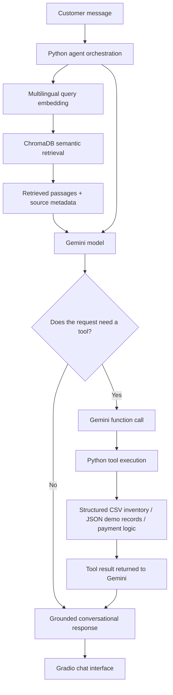

AI Real Estate Sales Agent
An intelligent real-estate sales assistant built with Retrieval-Augmented Generation (RAG), Gemini Function Calling, and Python tools. The assistant answers project-related questions from a curated knowledge base, searches structured property inventory, calculates estimated payment plans, and supports consent-based demo lead and viewing-request workflows.
Demo disclaimer: Nile Key Properties, its projects, property listings, prices, availability records, leads, and viewing requests are fictional data created strictly for a technical demonstration. This repository is not connected to a real estate company, live inventory platform, CRM, or booking calendar.

Table of Contents
- Project Overview
- Key Features
- Architecture
- Technology Stack
- Data Sources
- Available Agent Tools
- Repository Structure
- Getting Started
- Example Queries
- Grounding, Validation, and Safety
- Current Limitations
- Potential Enhancements
Project Overview
The goal of this project is to demonstrate how an AI sales assistant can combine unstructured knowledge retrieval with structured business tools in one conversational workflow.

The solution separates information by source:
- Descriptive information about projects, facilities, FAQs, and sales policies is retrieved from the PDF knowledge base.
- Exact property attributes—such as price, area, bedrooms, delivery date, and availability—are read from the CSV inventory.
- Payment estimates are calculated with deterministic Python logic rather than generated arithmetic.
- Lead and viewing-request actions are handled through Python functions and stored in the demo JSON file after the required consent and validation checks.
The assistant uses Gemini to understand customer requests, formulate responses, and decide when an approved function should be called. Python executes the selected function and returns its result to the model.
Key Features
- PDF knowledge ingestion: Extract page-level text with PyMuPDF while preserving page references.
- Text preprocessing: Normalize extracted text and remove extraction noise while retaining useful structure.
- Metadata enrichment: Attach source, page, section, project, content type, and topic metadata to document records.
- Recursive text chunking: Create overlapping chunks (configured to 1,200 characters with 180 characters of overlap) with traceable IDs.
- Multilingual semantic embeddings: Generate normalized vectors with intfloat/multilingual-e5-small for English and Arabic retrieval scenarios.
- Vector search: Store chunks, embeddings, and metadata in a persistent ChromaDB collection using cosine distance.
- Grounded RAG responses: Retrieve relevant passages and instruct Gemini to answer from the supplied evidence, acknowledge missing information, and cite source pages and chunk IDs.
- Structured property search: Filter inventory by area, district, project, budget, bedrooms, unit type, delivery, and availability.
- Property details lookup: Retrieve the structured record for a property ID.
- Payment-plan calculator: Calculate a simplified down payment, remaining balance, and estimated monthly installment from the selected unit's recorded terms.
- Consent-based workflows: Validate consent before saving a lead or creating a demo viewing request.
- Conversational interface: Provide an Arabic/English Gradio chat interface with sample questions.
Architecture
The project follows a single-agent, RAG + tool-calling architecture. Retrieval and tool execution are implemented in Python so the data flow and business rules remain inspectable.

Knowledge Retrieval Pipeline
PDF → Page-level extraction → Cleaning → Metadata enrichment → Chunking → Embeddings → ChromaDB → Semantic retrieval
Structured Tool Pipeline
Customer request → Gemini function call → Python validation and execution → CSV/JSON/calculator result → Gemini response
Technology Stack
Component	Technology	Role
Programming language	Python	Data processing, orchestration, and tools
LLM	Google Gemini API (google-genai)	Response generation and function calling
PDF processing	PyMuPDF	Page-aware text extraction
Embeddings	Sentence Transformers — intfloat/multilingual-e5-small	Multilingual semantic representations
Vector database	ChromaDB	Persistent vector storage and similarity search
Data processing	Pandas	Structured property inventory and filtering
Numerical operations	NumPy	Embedding arrays and validation
Interface	Gradio	Conversational demo UI
Development environment	Google Colab	Notebook-based execution and secret management

Data Sources
The demo uses three main data files. The companion roadmap text file documents the implementation steps and technical decisions.
File	Purpose	Source-of-truth responsibility
Nile_Key_Properties_Expanded_Knowledge_Base.pdf	Project descriptions, facilities, FAQs, sales process, and policies	Descriptive knowledge
Real_Estate_Properties_Demo.csv	Unit-level property records	Exact property facts, prices, payment terms, delivery, and availability
Real_Estate_Tools_Demo.json	Demo leads, viewing requests, and tool contract reference	Local demo workflow records
Nile_Key_Properties_Project_Roadmap_Interview_Guide.txt	Build roadmap and architecture rationale	Project documentation

Data-source rule: The PDF must not override the CSV for unit-specific facts. When an exact price or other required field is missing or invalid, the assistant should request sales-team confirmation rather than guess.
Available Agent Tools
The Gemini function declarations expose five Python tools:
Tool	Description
search_properties	Searches inventory using customer requirements such as location, budget, bedrooms, property type, delivery, and availability.
get_property_details	Returns the structured details for a specific property_id.
calculate_payment_plan	Calculates a simplified payment estimate using the unit's recorded price, down-payment percentage, and installment duration.
create_lead	Saves customer details only when explicit consent is provided and required fields are valid.
book_viewing	Creates a demo viewing request after consent, required details, availability, and a future date/time are validated.

Simplified Payment Formula
For a valid, available unit with a confirmed price:
Down payment = Unit price × Down-payment percentage
Remaining balance = Unit price − Down payment
Estimated monthly installment = Remaining balance ÷ Installment months
This is an illustrative estimate, not a formal quotation. The calculation excludes fees and contract-specific items such as maintenance deposits, taxes, registration, club membership, insurance, interest, and balloon payments.
Repository Structure
.
├── README.md
├── Real_Estate_AI_Sales_Agent.ipynb
├── Nile_Key_Properties_Expanded_Knowledge_Base.pdf
├── Nile_Key_Properties_Project_Roadmap_Interview_Guide.txt
├── Real_Estate_Properties_Demo.csv
└── Real_Estate_Tools_Demo.json
The notebook also creates intermediate artifacts during execution, including extracted and cleaned page data, metadata-enriched documents, chunk files, embedding files, and the local ChromaDB collection. These are generated as part of the workflow and are not required as source files in the repository.
Getting Started
The provided implementation is designed to run in Google Colab.
1. Open the notebook
Open Real_Estate_AI_Sales_Agent.ipynb in Google Colab.
2. Configure the Gemini API key
Create a Gemini API key and add it to Colab Secrets using this exact secret name:
GEMINI_API_KEY
Enable notebook access to the secret. The notebook reads the key from Colab Secrets; do not hard-code API keys in notebook cells or commit them to GitHub.
3. Provide the input files
When prompted by the notebook, upload these three required files with their original filenames:
- Nile_Key_Properties_Expanded_Knowledge_Base.pdf
- Real_Estate_Properties_Demo.csv
- Real_Estate_Tools_Demo.json
The roadmap text file is documentation and is not required by the execution pipeline.
4. Run the notebook
Run the notebook cells in order. The workflow installs its Python dependencies, validates the input files, processes the PDF, builds the embedding index, initializes ChromaDB, loads the structured inventory, and configures the Gemini agent tools.

The notebook uses Google Drive to persist and reload some intermediate artifacts. Approve the Google Drive mount request when prompted if you want to use those persistence steps.
5. Launch the chat interface
Run the final Gradio cells to start the conversational demo. The notebook requests a shareable Gradio link, which may expose the demo beyond your local Colab session. Review the security note below before enabling public sharing.
Before publishing or sharing: The notebook's final Gradio launch cell currently contains hard-coded demonstration authentication values. Replace this with credentials loaded securely from Colab Secrets (or remove public sharing) before committing or launching the notebook. Do not treat the sample authentication values as production security. Also verify that the Gemini model ID configured in the notebook is currently available to your API key; model availability can vary by account and over time.

Example Queries
Try questions such as:
What facilities does Palm Gate Residence offer?

عايز شقة 3 غرف في العاصمة الإدارية بحد أقصى 3 مليون جنيه.

Find an available apartment in New Cairo with a maximum budget of EGP 3.5 million.

What is the payment plan for CAP-201?

Compare Cedar Heights and Palm Gate Residence.

Is property NC-104 available?
The assistant is intended to answer in the customer's language when possible and use the structured tools whenever exact unit-level information or a calculation is required.
Grounding, Validation, and Safety
The notebook includes validation checks across several stages:
- Required PDF, CSV, and JSON files are checked before processing.
- Extracted pages are checked for empty text, page numbering, and unwanted null characters.
- Metadata records are checked for required fields, unique IDs, and valid scalar values.
- Chunks are checked for non-empty text, unique IDs, configured size limits, and preserved metadata.
- Embeddings are checked for vector count, expected dimensions, finite values, normalized vectors, and ID alignment.
- Retrieval examples cover English, Arabic, mixed-language queries, and metadata filtering.
- Tool functions validate property IDs, availability, prices, payment inputs, customer fields, consent, and viewing date/time.
The agent is designed to avoid unsupported claims. It should use retrieved evidence for descriptive answers, use the CSV for exact unit facts, and state when required information is missing. Lead capture and viewing-request actions require explicit customer consent.
Current Limitations
- Fictional data only: Project information, prices, units, customers, and transaction records are synthetic demo content.
- No live inventory: Availability reflects only the static CSV supplied with this repository.
- No real booking integration: A viewing action creates a local demo request; it does not reserve a real appointment or connect to a company calendar.
- Local demo persistence: Lead and viewing-request records are written to the JSON demo file, not to a production database or CRM.
- Simplified payment estimates: The calculator does not represent a binding financing offer and excludes additional charges and contract-specific conditions.
- Prototype deployment: Google Colab and a Gradio share link are suitable for demonstration, not a hardened production deployment.
- Model/API dependency: Gemini access, model identifiers, quotas, and SDK behavior depend on the provider configuration and may change.
Potential Enhancements
- Add a production database and a live inventory integration.
- Connect lead management to an authorized CRM with access controls and audit logging.
- Integrate a real appointment system with human approval and booking confirmation.
- Add automated unit tests and a repeatable retrieval evaluation suite with measured metrics.
- Add authentication, secret management, rate limiting, monitoring, and deployment hardening.
- Consider LangGraph if the workflow later requires explicit branching, retries, persistence, or human-in-the-loop orchestration.
